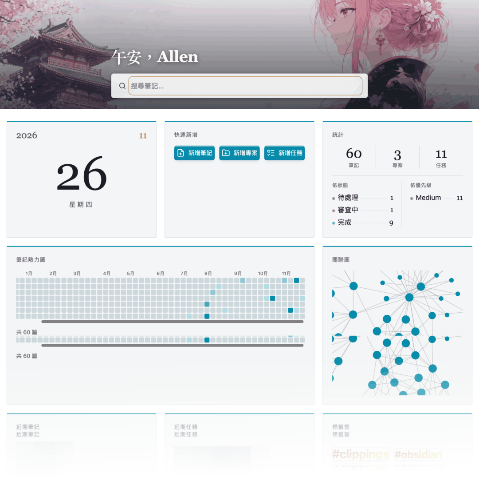

# OM Dashboard

[English](README.md) · [繁體中文](README.zh-TW.md) · [简体中文](README.zh-CN.md)



A custom Dashboard view that turns Obsidian into a personal workspace: see today at a glance, capture content quickly, and count notes, projects, and tasks.

---

## Part 1: For users

### Features

- **Header**: Configurable background image and greeting. It shows "Good morning / Good afternoon / Good evening" based on the current time, followed by your configured nickname (06:00–10:59 morning, 11:00–17:59 afternoon, 18:00–05:59 evening). Type a keyword in the search box and press Enter to open Obsidian's global search with the keyword prefilled.
- **Date card**: Shows today's year, month, day, and weekday (follows the system language).
- **Quick add**: Create a note, project, or task.
- **Statistics**: Shows note, project, and task counts. Tasks are grouped by status and priority; if dotpm defines colors, a matching color dot appears before each group.
- **Notes heatmap**: The left card in the second row shows how often notes were created over the last 12 months.
- **Graph**: The right card in the second row shows links between notes. Click a node to open its note; node colors follow the accent color setting.
- **Recent notes**: The left card in the third row lists the 10 most recently updated notes as `folder/title`. Click an entry to open it.
- **Recent tasks**: The middle card in the third row lists the 10 incomplete tasks with the nearest due dates. The first line shows `project/task`; the second line shows start date, due date, and progress in smaller text. Click an entry to open it.
- **Tag cloud**: The right card in the third row scales font size by tag usage and renders text with a rainbow gradient. Click a tag to open Obsidian's global search with `tag:#tag` prefilled.
- **Live updates**: The dashboard refreshes within about one second after a file is created, deleted, or renamed, or after note content changes.

### Requirements

- Obsidian 1.8.7 or later. The plugin does not restrict desktop platforms (`isDesktopOnly: false`).

#### Third-party plugin dependency

This plugin integrates with the following third-party plugin to provide full functionality. It still works when the plugin is not installed, but the related features degrade or fail:

- **dotpm / obsidian-pm**: A project management plugin. OM Dashboard's **Create project** and **Create task** buttons call its commands; task status and priority labels and colors are also read from its settings.
  - Project repo: https://github.com/dotpm/obsidian-pm
  - If it is not installed, both buttons remain visible but fail when used; labels fall back to their raw IDs.

### Installation

1. Download `om-dashboard.zip` from the GitHub Release.
2. Extract it and place the `om-dashboard` folder under `<vault>/.obsidian/plugins/`.
3. Reload Obsidian and enable **OM Dashboard** under **Settings → Community plugins**.

### Usage

Open the dashboard in either of two ways:

- Click the `layout-dashboard` icon in the left ribbon.
- Open the command palette and run **Open Dashboard** (command ID: `open-dashboard`).

Reopening reuses the existing Dashboard tab. When **Open on startup** is enabled in settings, a new tab is opened instead.

#### Settings

Go to **Settings → Community plugins → OM Dashboard**:

| Setting | Description | Default |
|---------|-------------|---------|
| Language | Follow Obsidian / Traditional Chinese / Simplified Chinese / English | Follow Obsidian |
| Nickname | Name shown in the header greeting. If blank, only the time-based greeting is shown. | Blank |
| Accent color | Main color for cards, icons, the heatmap, graph nodes, and the focus outline. Use the color picker or enter `#RRGGBB` directly. | `#65B2AB` |
| Notes root folder | Count only notes under this folder. If blank, count the whole vault (excluding dotpm projects and tasks). | Blank |
| Header background image location | Enter an image path inside the vault, or drag/select an image to upload it. Uploaded files are saved to `附件/OM Dashboard/banner.*`; 1920 × 640 px is recommended. | Blank |
| Open on startup | Automatically open the Dashboard in the main workspace when Obsidian starts. | Enabled |

UI text is managed centrally in `src/i18n.ts` and currently supports Traditional Chinese, Simplified Chinese, and English.

### Counting rules

Statistics read only Markdown frontmatter and never modify note content:

- `pm-project: true` → counted as a **project**, not a note.
- `pm-task: true` → counted as a **task**, not a note; `status` and `priority` are also read.
- Other Markdown files → counted as **notes**. If **Notes root** is set, only files in that folder (including subfolders) are counted.
- If `status` or `priority` is missing, the task is grouped as **Unset**.
- **Recent tasks** excludes statuses marked as complete in dotpm (`done` and `cancelled` by default) and sorts by `due` ascending. Tasks without `due` come last.

```yaml
---
pm-task: true
status: doing
priority: high
---
```

---

## Part 2: For contributors

### Development environment

- Node.js 18 or later (LTS recommended).
- Package manager: npm.
- Bundler: esbuild (`esbuild.config.mjs`).
- Types: `obsidian` type definitions (`latest`).

### Setup and common commands

```bash
npm install     # Install dependencies
npm run dev     # Watch mode; compile src/main.ts → main.js (inline sourcemap)
npm run build   # Type check (tsc -noEmit) + production build (minified, no sourcemap)
npm run lint    # ESLint (includes obsidianmd rules)
npm run version # Bump the version (version-bump.mjs) and git add manifest.json versions.json
```

### Project structure

Source code is split by responsibility under `src/`:

| File | Responsibility |
|------|----------------|
| `src/main.ts` | Plugin lifecycle, command registration, vault/metadata events, and refresh scheduling (1-second debounce) |
| `src/view.ts` | Dashboard rendering and interactions |
| `src/counters.ts` | Note, project, and task statistics |
| `src/recent.ts` | Recent notes and incomplete task lists |
| `src/tags.ts` | Tag statistics and tag cloud |
| `src/heatmap.ts` | Note creation heatmap |
| `src/graph.ts` | Note graph |
| `src/dotpm.ts` | Read dotpm status and priority settings |
| `src/settings.ts` | Settings interface and defaults |
| `src/settingsTab.ts` | Settings tab UI |
| `src/i18n.ts` | Three-language UI text |

Other root files:

- `esbuild.config.mjs`: Build configuration (entry `src/main.ts`, bundle, external obsidian/electron/codemirror, etc.).
- `tsconfig.json`: Strict TypeScript (`strict: true`).
- `eslint.config.mts`: ESLint configuration (includes `eslint-plugin-obsidianmd`).
- `manifest.json`, `versions.json`: Plugin metadata and version mapping.

### Development workflow

1. Run `npm run dev` to start watch mode.
2. After editing files under `src/`, esbuild recompiles `main.js`.
3. Reload the plugin in Obsidian (or restart Obsidian) to see the new version.
4. Before committing, run `npm run build` (type check) and `npm run lint`.

The build output `main.js` is not committed. It is attached directly to the GitHub Release alongside `manifest.json` and `styles.css`, and is also packaged into `om-dashboard.zip`; `node_modules/` is not committed either.

### Release

Follow Obsidian community plugin conventions:

1. Bump `version` in `manifest.json` (SemVer) and update `versions.json` with the corresponding minimum app version.
2. Run `npm run version` (or update the version files manually).
3. Run `npm run build` to produce `main.js`.
4. Create a GitHub Release. Its tag must exactly match the `version` in `manifest.json` with no leading `v`.
5. The Release workflow attaches `main.js`, `manifest.json`, and `styles.css` directly, and also packages `om-dashboard.zip` for manual installation.

### License

[GPL-3.0](LICENSE).
